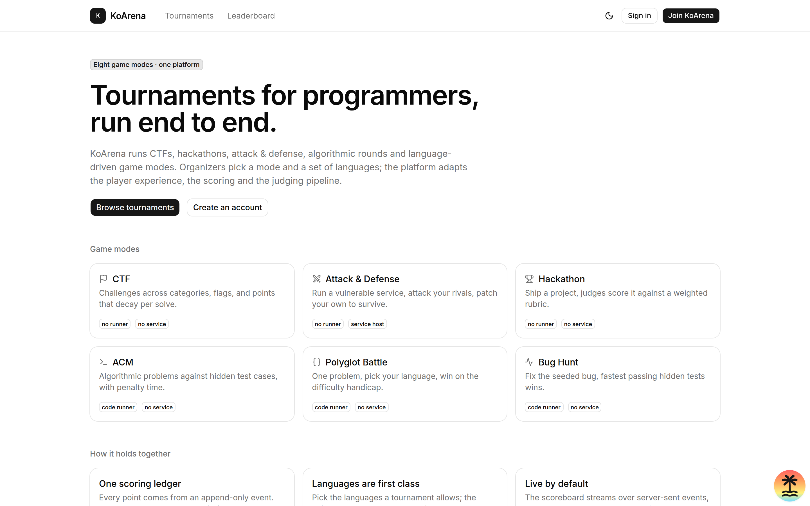
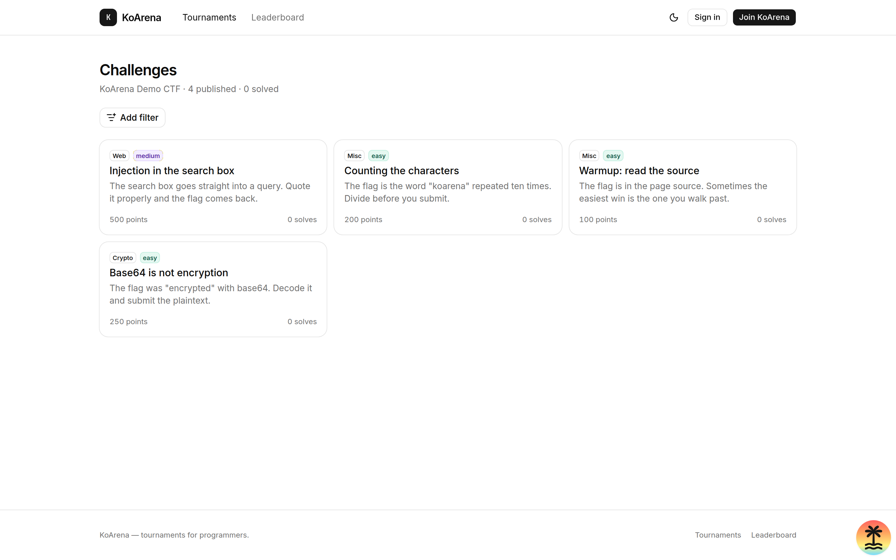
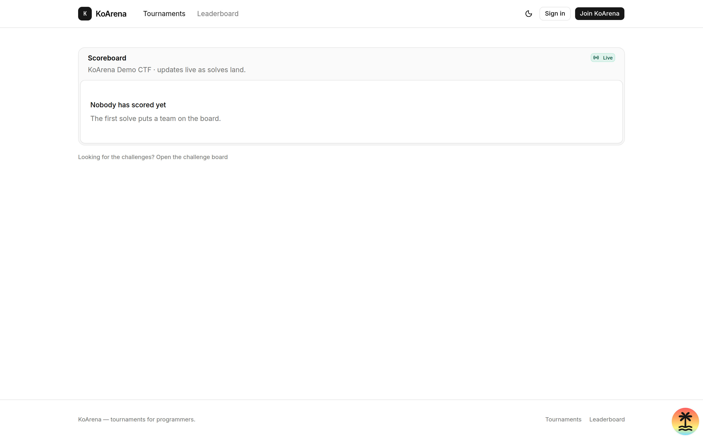
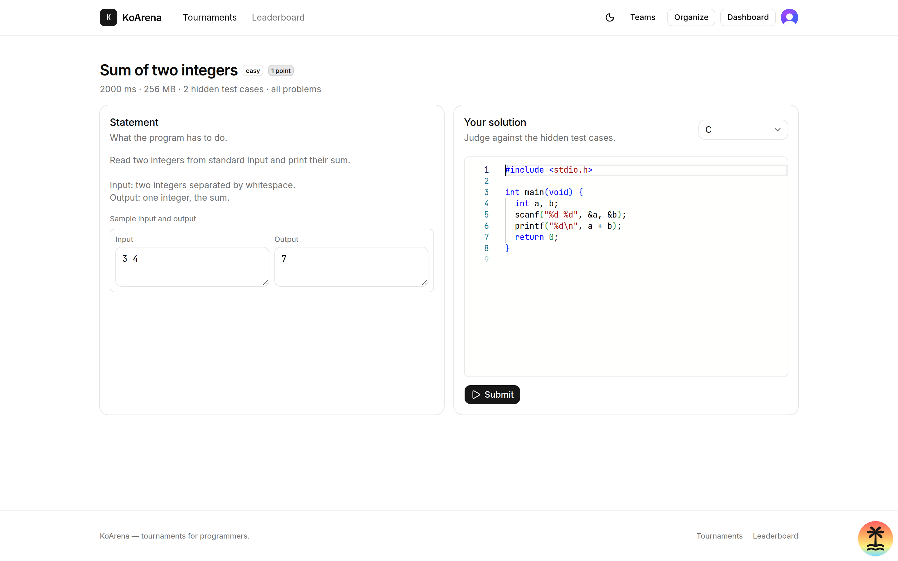
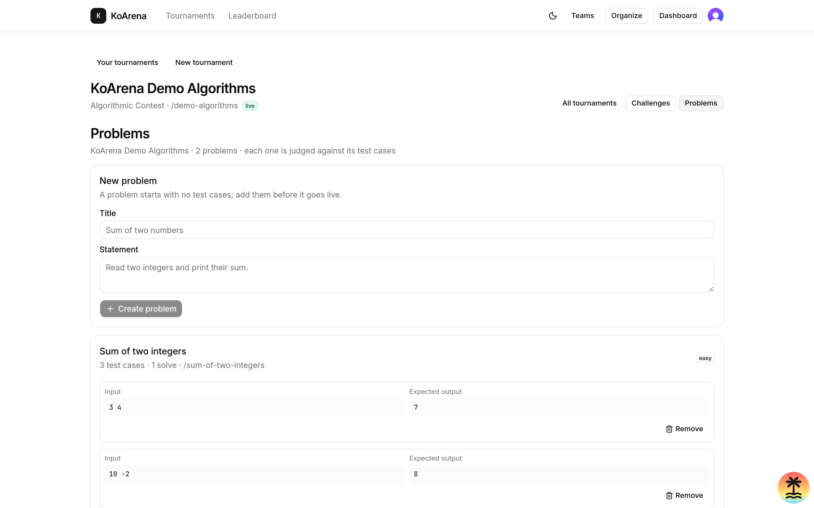

# KoArena

**Tournament platform for programmers.** CTF, hackathons, attack & defense,
algorithmic rounds, and language-driven game modes — one codebase, eight modes.

Organizers pick a mode and a set of languages; the platform adapts the player
experience, the scoring and the judging pipeline to match.



> **Status:** Phases 0–3 are built, tested and running. CTF and ACM are
> playable end to end; the hackathon mode is next. See the
> [roadmap](#roadmap).

---

## What it does

**Eight game modes, one engine.** The scoring rules of every mode live in
`packages/game` — a pure, dependency-free TypeScript library with no database
and no I/O. The web app and the judging worker both call it, so the board, the
card and the award can never disagree about who won.

| Mode | What it is | Needs |
| --- | --- | --- |
| **CTF** | Challenges across categories, encrypted flags, points that decay per solve | — |
| **ACM** | Algorithmic problems against hidden test cases, with penalty time | code runner |
| **Hackathon** | Ship a project, judges score it against a weighted rubric | — |
| **Attack & Defense** | Run a vulnerable service, attack your rivals, patch your own | code runner + service host |
| **Polyglot Battle** | One problem, pick your language, win on the difficulty handicap | code runner |
| **Golf Royale** | Code golf: shortest program that passes wins | code runner |
| **Bug Hunt** | Fix the seeded bug; the fastest passing the hidden tests wins | code runner |
| **Knockout** | Brackets, elimination, seeding | — |

**One scoring ledger.** Every point comes from an append-only `ScoreEvent`.
The leaderboard is a snapshot rebuilt from that log, so the board can be
repaired from the events at any time and two boards can never tell different
stories.

**Languages are first class.** A tournament picks its languages and the
platform adapts: the editor, the runner, the weights and the difficulty
handicap all follow. 23 languages are seeded out of the box.

**Live by default.** The scoreboard streams over Server-Sent Events with
Redis pub/sub fan-out. A solve in one browser moves the board in every other
one, with no reload.

---

## Screenshots

| | |
| --- | --- |
|  |  |
| The CTF challenge board | The live scoreboard |
|  |  |
| An ACM problem, the editor and the verdict | The organizer's problem and test case manager |

---

## Quick start

You need **Node 22+**, **pnpm 10+**, a **Postgres** and a **Redis**.

```bash
git clone https://github.com/koamishin/koarena.git
cd koarena
pnpm install

# Postgres and Redis in Docker
pnpm infra:up

cp .env.example packages/db/.env
cp .env.example apps/web/.env
cp apps/judge/.env.example apps/judge/.env

# A 32-byte key for the flag encryption — the same key must be in
# apps/web/.env and in the seed's environment
echo "FLAG_ENCRYPTION_KEY=\"$(openssl rand -base64 32)\"" >> apps/web/.env

pnpm db:generate
pnpm db:migrate
pnpm db:seed            # 23 languages + a demo organization
pnpm db:seed:demo       # a four-challenge CTF and a two-problem ACM round

pnpm dev                # the app, on http://localhost:3100
pnpm dev:judge          # the judging worker, in a second terminal
```

Open <http://localhost:3100>, create an account, and pick a team.

> The dev server is pinned to **port 3100** (`--strictPort`). Clerk ties its
> sign-in redirect to the origin, so a changing port breaks the flow.

`apps/web/.env.local` holds the Clerk keys. Run `npx clerk@latest auth login`
to claim the application, or paste your own publishable and secret keys.

### Trying the two modes

```bash
pnpm db:seed:demo
```

**`/tournaments/demo-ctf`** — four challenges with encrypted flags, live point
decay and first blood. Submit a flag and watch the scoreboard move in another
tab.

**`/tournaments/demo-algorithms`** — the ACM mode. Two problems with hidden
test cases, a Monaco editor and a real verdict. Submit a program; the worker
runs it against the test cases and the verdict comes back over the live
channel.

The demo runs with the **simulated** runner, so no sandbox is needed: the
verdict comes from a marker in the source — `/* verdict:wrong-answer */`,
`/* verdict:time-limit */`, `/* verdict:compile-error */` or
`/* verdict:runtime-error */`. Without a marker the program is accepted.

---

## How the judging works

```
browser ──▶ apps/web ──▶ submission row + a job in Redis
                               │
                               ▼
                        apps/judge (the worker)
                               │
                               ▼
                   packages/runner ──▶ Judge0
                               │
                               ▼
              verdict + score event + live event
```

The app never talks to the sandbox. The job carries **only the submission
id**; everything else is read from the database, so a job can be replayed by
hand and the database stays the source of truth.

The worker calls `@koarena/game` for the points and the penalty, so the rules
live in one place and the worker never re-implements them.

Three runners, one interface:

| `RUNNER_MODE` | What it does | Use it for |
| --- | --- | --- |
| `judge0` | Submits to a Judge0 instance and polls for the verdict | Production |
| `local` | Really executes the program on the worker, with a timeout | Development only — it runs untrusted code with the worker's own privileges, so it refuses to start unless `RUNNER_ALLOW_LOCAL_EXECUTION=true` |
| `simulated` | Decides the verdict from a marker in the source | A clone with no sandbox: the whole queue → worker → verdict → penalty → board path still runs |

---

## Architecture

```
apps/web          TanStack Start app (SSR, server functions, file-based routes)
apps/judge        BullMQ worker — runs the code, writes the verdicts
packages/db       Prisma schema, generated client, seed (48 models, 24 enums)
packages/game     Pure scoring engine — all 8 modes, no I/O, 26 unit tests
packages/ledger   The score ledger — append-only, shared by the app and the worker
packages/queue    The judging queue — one job shape, both ends
packages/runner   The runner contract: Judge0 client, local runner, simulated runner
packages/crypto   Flag encryption (AES-256-GCM) and timing-safe comparison
packages/realtime The live bus (Redis pub/sub + the event contract)
infra             Docker Compose (Postgres, Redis, MinIO)
docs              Plan, game modes, routes, deployment
```

### The server/client boundary

TanStack Start compiles server functions into RPC stubs for the browser, but
only if server-only code is genuinely server-only. KoArena uses three layers:

```
features/<domain>/
├── <domain>.server.ts      server-only: DB calls, Clerk calls — never imported by the client
├── <domain>.functions.ts   createServerFn wrappers — safe to import anywhere
├── types.ts                DTO types — importable from components
└── components/             client components
```

`*.server.ts` files are **denied in the client environment** by TanStack
Start's import protection, configured to fail the production build:

```ts
// apps/web/vite.config.ts
tanstackStart({
  importProtection: { behavior: { dev: 'mock', build: 'error' } },
})
```

Two rules keep this working:

1. A `*.server.ts` module may only be referenced **inside** a server function
   handler. A helper that touches the database outside a handler keeps the
   import alive and the build fails.
2. Server function return types must be **serializable**. A `Date` or an
   `unknown` in a return type collapses the inferred type — return ISO strings
   and use `JsonValue` for config objects.

The same applies to the workspace packages: `@koarena/db`, `@koarena/crypto`,
`@koarena/realtime`, `@koarena/ledger`, `@koarena/queue` and `@koarena/runner`
are all denied in the client environment. A **dynamic** `import('@koarena/db')`
fails the build too: the compiler does not prune dynamic imports, so the
database client would head for the browser bundle. Put the query behind a
server function instead.

---

## Configuration

| Variable | Where | Notes |
| --- | --- | --- |
| `DATABASE_URL` | app + worker | Pooled TCP URI. Use the **pooled** endpoint: serverless concurrency will exhaust direct connections. |
| `REDIS_URL` | app + worker | Classic TCP Redis. BullMQ needs blocking commands, so Upstash will not do. |
| `FLAG_ENCRYPTION_KEY` | app + worker | 32-byte base64 key for AES-256-GCM flag encryption. |
| `CLERK_SECRET_KEY` | app | Server only — never exposed to the client. |
| `CLERK_PUBLISHABLE_KEY` | app | Public. |
| `CLERK_WEBHOOK_SECRET` | app | Signs the Clerk user webhooks. |
| `RUNNER_MODE` | worker | `judge0`, `local` or `simulated`. |
| `JUDGE0_URL` / `JUDGE0_API_KEY` | worker | The sandbox. |
| `JUDGE_CONCURRENCY` | worker | Submissions judged at once — keep it below Judge0's `RUNNERS`. |

Full topology, sizing and the deploy sequence: **[docs/DEPLOYMENT.md](./docs/DEPLOYMENT.md)**.

---

## Commands

| Command | What it does |
| --- | --- |
| `pnpm dev` | Run the app (and the worker) in watch mode |
| `pnpm dev:judge` | Run only the judging worker |
| `pnpm build` | Build all packages |
| `pnpm lint` | Biome check |
| `pnpm typecheck` | `tsc --noEmit` across the workspace |
| `pnpm test` | Vitest across the workspace (the DB suites need `DATABASE_URL`) |
| `pnpm db:generate` / `db:migrate` / `db:deploy` / `db:seed` / `db:studio` | Prisma |
| `pnpm infra:up` / `infra:down` | Local Postgres, Redis (and MinIO with `--profile storage`) |

---

## Roadmap

| Phase | Scope | Status |
| --- | --- | --- |
| 0 · Foundations | Monorepo, TanStack Start 1.0, Tailwind v4, shadcn + ReUI, Prisma 7, Redis, CI, Clerk | **Done** |
| 1 · Identity & org | Clerk roles and sync, teams and invites, tournament CRUD, the organizer wizard | **Done** |
| 2 · CTF vertical slice | Challenges, encrypted flags, dynamic scoring, live scoreboard over SSE | **Done** |
| 3 · Code runner | Monaco, Judge0, the BullMQ worker, the ACM mode, test cases, penalties | **Done** |
| 4 · Hackathon | Project submissions, rubrics, judge assignment, judge queue, awards | Next |
| 5 · Security & scale | Plagiarism detection, audit log, moderation, rate limits, load test | |
| 6 · Attack & Defense | Service deployment, bots, attack capture, patch scoring, kill feed | |
| 7 · Language modes | Polyglot Battle, Golf Royale, Bug Hunt, Knockout brackets, language roulette | |

The full plan, the architecture decisions and the risks are in
**[PLAN.md](./PLAN.md)**.

---

## Documentation

* **[PLAN.md](./PLAN.md)** — product scope, architecture, roadmap, risks, and what each phase actually built
* **[docs/GAME-MODES.md](./docs/GAME-MODES.md)** — the rules and the scoring formulas for all 8 modes
* **[docs/ROUTES.md](./docs/ROUTES.md)** — the route and screen map
* **[docs/DEPLOYMENT.md](./docs/DEPLOYMENT.md)** — the Vercel + managed Postgres topology
* **[packages/db/prisma/schema.prisma](./packages/db/prisma/schema.prisma)** — the data model
* **[docs/plan-overview.html](./docs/plan-overview.html)** — a visual plan summary

---

## Stack

| Layer | Choice |
| --- | --- |
| Framework | [TanStack Start](https://tanstack.com/start) 1.0 (React 19, Vite 8, TanStack Router) |
| Data | PostgreSQL + Prisma 7 (Rust-free, driver adapters) |
| Auth | [Clerk](https://clerk.com) (`@clerk/tanstack-react-start`) |
| Design | shadcn/ui (Base UI, `base-nova`) + [ReUI](https://reui.io) on Tailwind CSS v4 |
| Editor | Monaco, loaded client-only |
| Sandbox | [Judge0](https://judge0.com) |
| Queue | BullMQ over Redis |
| Realtime | Server-Sent Events over Redis pub/sub |
| Tooling | pnpm workspaces + Turborepo, Biome, Vitest, Playwright, GitHub Actions |

---

## Contributing

Issues and pull requests are welcome. Before you start:

```bash
pnpm install
pnpm check        # lint + typecheck + test
```

The rules that matter most:

* `packages/game` contains **zero** imports from `apps/` or `prisma`. It takes
  plain data and returns plain data.
* Anything that touches the database or Clerk goes in a `*.server.ts` file and
  is only called from inside a server function handler.
* The design system is shadcn/ui + ReUI. Use the installed components; do not
  hand-roll a lookalike. `AGENTS.md` has the rules.
* A phase is not done until it has been driven in a real browser. Several
  bugs that passed every unit test only showed up there — the list is in
  [PLAN.md](./PLAN.md#bugs-the-live-browser-test-caught).

---

## License

**AGPL-3.0-or-later** — see [LICENSE](./LICENSE).

Copyright (C) 2026 KoamiShin.

The AGPL is the right fit for a hosted-from-source platform: if you run a
modified KoArena and let users reach it over a network, you must offer them
the source of your version. Section 13 of the license says exactly how.

Built by the KoamiShin team with [T3 Code](https://t3.codes).
